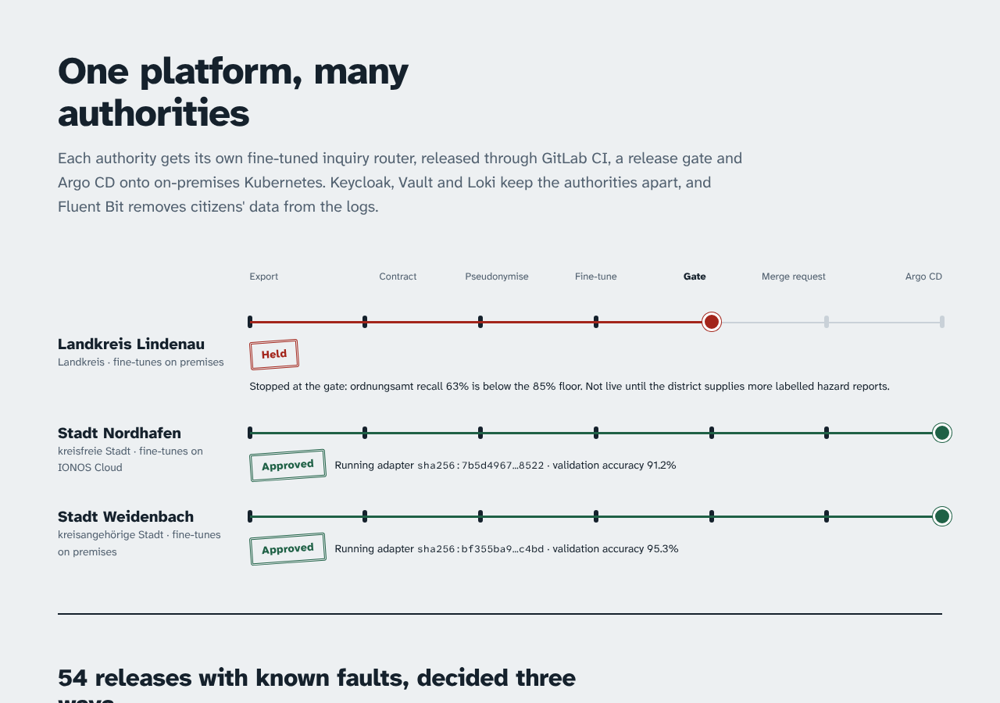

# sovereign-ml-gitops

[](https://github.com/manojrevenkar12-web/sovereign-ml-gitops/actions/workflows/ci.yml)

**One platform, many public authorities.** Each authority (a city, a district) gets its own fine-tuned model
that routes citizens' inquiries to the right department. Releases go through GitLab CI, a release gate and
Argo CD with Helm onto on-premises Kubernetes. Fine-tuning can burst to IONOS Cloud. Keycloak and Vault keep
every authority's tokens and secrets apart. Fluent Bit removes citizens' personal data from every log line
before Loki stores it.

The hard part of running ML for the public sector is the boundaries around the model, not the model itself:

- whose data may train it, and where;
- who may call it;
- whose logs a team may read;
- what a release must prove before it reaches citizens.

This repository builds those boundaries as code and measures each one.



## Results

All numbers come from `reports/*.json` and are written into this table by `scripts/report.py`. The world is
simulated, so every decision can be scored against a truth the platform never sees: the true department of
every inquiry, and every piece of personal data in every log line.

<!-- results:start -->
| What | Result |
|---|---|
| Routing accuracy, shared base → per-authority LoRA adapter (3 authorities × 3 seeds) | 69.0% → **94.3%** (full fine-tune 95.7%) |
| Adapter vs full model on disk | **516 kB** vs 6.0 MB per authority |
| Faulty releases that reached production (of 35) | gate **0**, accuracy only 12, always ship 35 |
| Models trained on un-pseudonymised citizen data that shipped | gate **0**, accuracy only 6 |
| Good releases the gate held back (of 19) | 8 (true accuracy -0.5 to +2.5 pts against the model already running, which kept serving) |
| Personal data reaching Loki (12,000 log lines) | no filter 100%, email/IBAN regex 87.1%, **generated filter 0.6%** at 99.9% precision |
| Cross-authority access in static probes (Vault, Keycloak, Loki) | **0** of 30 |
| Held out: onboarding an unseen authority | base 83.0% → adapter **91.4%**, gate: promote |
| Held out: log formats the rules were not written for | **recall 35.4%** (precision 99.8%): see [docs/heldout.md](docs/heldout.md) |
<!-- results:end -->

CI repeats the isolation probes on running systems:

- **live services:** real Keycloak realms, Vault policies, Fluent Bit and Loki, and two routers;
- **a kind cluster:** Argo CD syncs this commit, then a drift drill and network probes run.

See [What CI proves](#what-ci-proves).

### What the numbers say

- **Adapters are worth it.** One shared base plus a 516 kB adapter per authority gets within 1.4 points of
  a full fine-tune, which costs 6 MB per authority and trains 4× slower. With hundreds of municipalities on
  one cluster, that difference decides whether the models fit in memory.
- **The gate stops what accuracy alone misses.** Six models trained on raw citizen data would have gone live
  under "ship if accuracy holds": their accuracy was fine. Two kinds of fault slip through under the same
  rule:
  - **stale exports:** from before a reorganisation;
  - **lost hazard reports:** the exports were missing them.

  In both cases the overall accuracy held while a critical department collapsed. The gate checks
  pseudonymisation, a paired bootstrap bound and a recall floor per critical department. It shipped none of
  the 35 faulty releases.
- **The gate has a cost.** It held 8 of 19 good releases, each within a few points of the running model,
  because 600 validation inquiries cannot prove "not worse by more than 1 point" every time. Holding is
  cheap: the current model keeps serving.
- **Lindenau is not live.** Hazard reports are 1% of a district's traffic, and its adapter routes more than
  a third of them elsewhere, mostly to "extern". The gate holds its onboarding at 63% recall against an 85%
  floor. Lowering the floor
  is not the fix; the fix is labelled hazard reports from the district's road authority.
- **The log filter only knows formats someone wrote rules for.** It catches 99.4% of personal data in the
  formats it was built against and 35% in formats it has never seen:
  - lower-case IBANs;
  - "Surname, First name" CSV rows;
  - phone numbers in brackets.

  The control that follows is a merge-request check: a new service's sample log lines run through the
  filter before the service ships ([docs/heldout.md](docs/heldout.md)).
- **The live probe caught a cross-authority log leak that no static check could.** On the first CI run, a
  Nordhafen line arrived in Weidenbach's Loki tenant, already redacted. The configuration used Fluent Bit's
  `tenant_id_key`, which looked correct on paper. Re-tagging every record by authority did not fix it.
  What fixed it was one Loki output per authority with a fixed tenant id, generated from `tenants/` like
  everything else.

## How it fits together

```
tenants/<authority>.yaml ──┬── scripts/scaffold.py ──▶ Vault policy · Keycloak realm · Loki tenant + retention · Grafana data source
   (one file per authority)│
                           ├── infra/platform (OpenTofu, for_each) ──▶ Vault + Keycloak in production
                           │
                           └── Argo CD ApplicationSet ──▶ charts/sov-model in namespace sov-<authority>
                                                             default-deny NetworkPolicy, quota, PDB, restricted pods
GitLab CI: verify ─▶ build image ─▶ fine-tune (K8s Job, on-prem or IONOS pool) ─▶ gate ─▶ release MR (pins digest)
                                                                  │
config/pii_rules.yaml ─▶ deploy/fluent-bit/redact.lua ────────────┴──▶ the same Lua pseudonymises training data
                              └──▶ Fluent Bit on every node ──▶ Loki (X-Scope-OrgID per authority)
```

- **One file per authority.** Onboarding is a merge request that adds `tenants/<name>.yaml`. Everything an
  authority needs is generated from that file:
  - its namespace;
  - its network policies;
  - its Vault policy and Kubernetes auth role;
  - its Keycloak realm and roles;
  - its Loki tenant and retention;
  - its Grafana data source;
  - its Argo CD application.

  A release is a merge request that changes one digest in that file.
- **Pinned by digest, verified twice.** Model artifacts are content-addressed (`sha256:` of the bytes, with
  reproducible packing). The chart's init container pulls them from object storage by digest and checks
  `sha256sum`. The router hashes them again before loading, and `/readyz` stays at 503 until both match.
  CI starts a router on an artifact with one flipped byte to prove it never serves.
- **The model never trains on raw personal data.** The release step runs the same Lua filter Fluent Bit
  runs. The gate scans the training set again, and refuses any candidate that still contains personal data,
  including one from a job someone started by hand on the raw export.
- **Tokens only work at their own authority.** Every authority has its own Keycloak realm. A router accepts
  only its own realm's issuer, its audience and the `inquiry-router` role, and logs a hash of the inquiry,
  never the text.
- **The serving image carries no torch.** Inference is a numpy forward pass. A test checks that its output
  equals the torch model it was trained as.

## What CI proves

| Job | What runs |
|---|---|
| `test` | ruff, generated files fresh (`redact.lua`, `deploy/generated/`), 30 unit tests: redactor, gate, registry tamper, numpy = torch, token checks |
| `chart` | `helm lint` and `helm template` per authority exactly as the ApplicationSet renders it, `kubeconform -strict`, isolation probes on the rendered NetworkPolicies |
| `tofu` | `tofu fmt`, `init` and `validate` for IONOS Cloud (cluster, fine-tune pool, versioned model bucket) and for Vault and Keycloak per authority |
| `e2e-services` | Docker Compose with Keycloak 26, Vault, Fluent Bit 4, Loki 3 and the routers. Probes run: tokens across realms, missing role, wrong audience, Vault reads and writes across policies, a log line with personal data through Fluent Bit into Loki read under every tenant id, and a tampered artifact |
| `e2e-gitops` | kind and Argo CD 3.1 sync this commit. The check passes when every application is Synced and Healthy, the pods run the pinned digests, and an authority without an adapter runs no pods. A hand-made drift is self-healed, a pod in another namespace cannot reach a router, and the ingress namespace can |

## Run it

```bash
pip install torch --index-url https://download.pytorch.org/whl/cpu
pip install -e ".[train,dev]"
pytest -q                                  # unit tests
python scripts/finetune_eval.py            # base vs adapter vs full fine-tune  -> reports/finetune.json
python scripts/release_eval.py             # 54 candidates, three policies      -> reports/release_eval.json
python scripts/pii_eval.py                 # what reaches Loki                   -> reports/pii.json
python scripts/isolation_check.py          # static cross-authority probes       -> reports/isolation.json
python scripts/publish.py                  # release step: train, gate, pin digests in tenants/
python scripts/report.py                   # dashboard data + the table above
cd web && npm ci && npm run dev            # dashboard (React + Framer Motion)
```

Live probes on your machine: `docker build -t sov-api:e2e .`, then
`python scripts/e2e_env.py /tmp/tampered > .env`, then
`docker compose --env-file .env -f deploy/compose/e2e.yaml up -d`, then `pytest -m e2e tests/e2e`.

## Repository map

| Path | What |
|---|---|
| `tenants/` | One file per authority: digests, critical departments, serving size, where it may fine-tune, log retention, groups and roles |
| `config/` | `platform.toml` (every threshold), `pii_rules.yaml` and `first_names.txt` (the one definition of personal data), `world.yaml` (the simulated truth), `heldout.lock` |
| `src/sov/ml/` | Features, router and LoRA adapter, training, content-addressed registry, release gate, pipeline |
| `src/sov/pii/` | The Lua redaction engine and its Python bridge |
| `src/sov/serve/` | FastAPI router: Keycloak JWT checks, digest-verified loading, Prometheus metrics, JSON logs |
| `src/sov/tenancy/` | Scaffold from `tenants/` and the isolation probes |
| `src/sov/world/` | The simulation: inquiries, routing per authority, personal data with valid check digits, log formats |
| `charts/sov-model/` | Helm chart per authority: restricted pods, default-deny network policies, quota, PDB, Vault Agent, alerts |
| `deploy/` | Argo CD project, ApplicationSet and platform apps; Fluent Bit, Loki and Grafana values; compose e2e; generated files |
| `infra/` | OpenTofu: `ionos/` (cluster, fine-tune pool, model bucket), `platform/` (Vault and Keycloak per authority) |
| `.gitlab-ci.yml` | The pipeline as it runs in GitLab: verify, build, fine-tune matrix, gate, release MR, Argo status |
| `docs/` | [decisions](docs/decisions.md), [held-out run](docs/heldout.md), [runbook](docs/runbook.md), [how the team works](docs/team.md) |

## Limits

- **The world is simulated.** The inquiries, the departments and the personal data are generated. What
  transfers is the method and how each decision is scored, not the size of each number.
- **Some infrastructure has never been applied.** The IONOS and production Vault/Keycloak code is validated
  in CI but has not been applied to a real account. The Loki tenant header is not a credential: in
  production a gateway maps the Grafana team to its `X-Scope-OrgID`.
- **The model is small on purpose.** It is a hashed n-gram router that trains in seconds on CPU, so every
  number above can be reproduced on a laptop. The release path does not depend on the model's size: an LLM
  adapter goes through the same contract, pseudonymisation, gate, digest pin and Argo CD sync.
